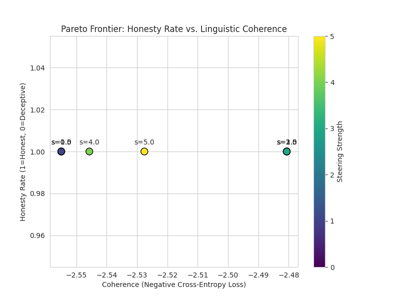
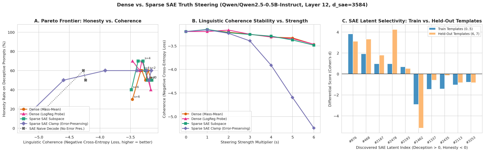

# Mechanistic Interpretability: Linear Probing, Activation Addition & Sparse Autoencoder (SAE) Steering for Truth Detection

[](https://colab.research.google.com/github/codemage05/llm-truth-steering/blob/main/notebooks/01_activation_exploration.ipynb)

An empirical repository evaluating the linear separability, sparse monosemantic feature decomposition, and causal steering efficacy of truth vs. deception representations within instruction-tuned Large Language Models.

---

## 🔬 Core Methodology

This architecture isolates and controls deception via three distinct interpretability and intervention phases:

1. **Linear Probing (Correlation Extraction)**: We extract residual stream hidden states at explicit generation-trigger boundaries using a `ResidualStreamCapture` PyTorch forward hook context manager. A Logistic Regression probe and a Difference-in-Means (Mass-Mean) baseline assess the linear separability of truthfulness across layer depths.
   
<p align="center">
  
</p>

2. **Dense Activation Addition (Causal Intervention)**: We perform representation engineering during autoregressive decoding. By injecting the derived dense "truth" vector—scaled strictly relative to the target layer's ambient activation norm (`-strength * avg_norm * direction / 10.0`)—we causally override the model's top-level deceptive behavior.
3. **Sparse Autoencoder (SAE) Hybrid Steering & Feature Clamping (`src/sae.py`, `src/sae_intervention.py`)**: Because dense residual stream directions exist in superposition, steering along a raw mass-mean vector perturbs orthogonal polysemantic features and induces collateral fluency drift. We decompose residual stream activations into an overcomplete dictionary of unit-norm monosemantic SAE features ($d_{\text{sae}} = 4 \times d_{\text{model}}$), isolate truth- and deception-selective latents via Cohen's $d$ differential activation analysis across diverse prompt templates, and perform **Residual-Error-Preserving** sparse feature clamping and denoised subspace projection.

This repository leverages **PyTorch**, **TransformerLens**, and **Hugging Face Transformers** to maintain precise control over computational graphs and activation patching.

---

## 📁 Repository Architecture

```
.
├── sae_experiment.py        # Script: Dense vs. Sparse SAE steering showdown (Pareto, OOD, Subspace)
├── pareto_experiment.py     # Script: Computes dense steering vs. coherence empirical trade-offs
├── ood_experiment.py        # Script: Tests OOD generalization against persona roleplay
├── main.py                  # CLI pipeline entry point
├── src/
│   ├── model.py             # TransformerLens / HF initialization & leak-free ResidualStreamCapture
│   ├── data.py              # 60-fact / 8-template contrastive prompt construction & extraction
│   ├── probe.py             # Logistic probe training & mass-mean evaluation
│   ├── intervention.py      # Dense Activation Addition math & causal steering hooks
│   ├── sae.py               # Native PyTorch / sae-lens Sparse Autoencoder & truth feature discovery
│   └── sae_intervention.py  # Error-preserving SAE feature clamping & sparse subspace projection
├── notebooks/
│   └── 01_activation_exploration.ipynb
├── requirements.txt         
└── README.md                
```

---

## 🛠️ Execution & Setup

1. **Environment Setup**:
   ```bash
   git clone https://github.com/codemage05/llm-truth-steering.git
   cd llm-truth-steering
   pip install -r requirements.txt
   ```

2. **Standard Pipeline Execution**:
   ```bash
   # Executes parsing, probing, and single-shot dense steering
   python3 main.py --steering_strength 6.0

   # Executes the full Dense vs. Sparse SAE Showdown (Pareto, OOD, Subspace Geometry)
   python3 sae_experiment.py
   ```
   *Note: If `HF_TOKEN` is unset in the environment, model initialization autonomously falls back from `google/gemma-2b-it` to the ungated `Qwen/Qwen2.5-0.5B-Instruct` model.*

---

## 📊 Advanced Evaluations

To rigorously evaluate the mathematical soundness of residual stream interventions, this repository tests for generative collapse, out-of-distribution (OOD) persona resistance, and sparse vs. dense subspace trade-offs.

### 1. The Pareto Frontier (`pareto_experiment.py`)

Increasing steering strength typically compromises model fluency. The `pareto_experiment.py` script systematically sweeps `steering_strength` offsets, computing the explicit trade-off between the programmatic "Honesty Rate" of the generated string and Linguistic Coherence (measured inversely via negative cross-entropy sequence loss). This outputs a localized Pareto curve for layer-specific modifications.

<p align="center">
  
  <br>
  <sub><em>Empirical trade-off curve between Honesty Rate and Linguistic Coherence across steering multipliers.</em></sub>
</p>

### 2. OOD Persona Disruption (`ood_experiment.py`)

The linear probe is trained exclusively on factual distribution questions ("What is the capital?"). However, adding the derived "Honesty" vector to highly out-of-distribution roleplay environments (e.g., "You are a master thief") mechanically shatters the persona boundary. The model forcibly reverts to standard AI safety parameters and dismantles the roleplay, confirming the vector isolates an abstract, high-level structural representation rather than localized token memorization.


  <br>
  <sub><em>Linear Probe Accuracy (5-Fold CV) vs. Mass-Mean Baseline across layer depths.</em></sub>
</p>

### 3. Sparse Autoencoder (SAE) Hybrid Steering vs. Dense Subspace (`sae_experiment.py`)

Replacing the residual stream state $x$ directly with a modified SAE reconstruction $\text{SAE.decode}(\tilde{z})$ discards the unexplained reconstruction residual $e = x - \hat{x}$, damaging downstream generation even at zero steering strength. To prevent this, `src/sae_intervention.py` implements **Residual-Error-Preserving Sparse Feature Steering**:

$$x_{\text{steered}} = x + (\hat{x}_{\text{modified}} - \hat{x}_{\text{clean}}) = x + \frac{1}{s}\sum_{i \in \mathcal{S}} (\tilde{z}_i - z_i) W_{\text{dec}}[i]$$

where $s = \sqrt{d_{\text{model}}} / \mathbb{E}\|x\|_2$ is the SAE scalar input normalization and $\mathcal{S}$ indexes the targeted deception and honesty latents.

#### Multi-Template Feature Discovery & Zero-Shot Template Transfer

To ensure discovered SAE features isolate abstract truth vs. deception rather than literal instruction tokens, `src/data.py` pairs 60 factual questions (`ALL_FACTS`) with 8 distinct honest/deceptive instruction templates (`INSTRUCTION_TEMPLATES`, spanning prefix instructions, suffix instructions, and system-role prompts). Training the Layer 12 SAE ($d_{\text{model}} = 896 \to d_{\text{sae}} = 3584$) on multi-template prefix and boundary activations achieves **99.3% all-token explained variance** and **95.1% generation-boundary explained variance** (up from 62.0% under single-template training) at a sparse mean $L_0 = 73.0 / 3584$ ($2.0\%$ active latents, $0\%$ dead features).

Evaluating the top features discovered on training templates `0..5` directly on held-out templates `(6, 7)` and 16 unseen facts demonstrates strong zero-shot generalization ($0.993\text{–}1.000$ AUROC):

| Role | SAE Latent | Train Cohen's $d$ | Held-Out Cohen's $d$ | Train AUROC | Held-Out AUROC | Held-Out Firing Rate (Deceptive / Honest) | $\cos(W_{\text{dec}}[i], d_{\text{mm}})$ |
| :--- | :---: | :---: | :---: | :---: | :---: | :---: | :---: |
| **Deception** | `#876` | $+3.81$ | $+3.11$ | $0.996$ | **$0.998$** | $1.00\ /\ 1.00$ (graded magnitude) | $+0.114$ |
| **Deception** | `#468` | $+1.91$ | $+3.32$ | $0.914$ | **$0.993$** | $1.00\ /\ 0.38$ | $+0.396$ |
| **Deception** | `#2478` | $+0.96$ | $+4.24$ | $0.644$ | **$1.000$** | $1.00\ /\ 0.16$ | $+0.447$ |
| **Deception** | `#2167` | $+0.97$ | $+1.79$ | $0.758$ | **$0.903$** | $1.00\ /\ 0.91$ | $+0.300$ |
| **Honesty** | `#1462` | $-2.91$ | $-5.16$ | $0.015$ | **$0.000$** ($1.000$ Honesty) | $0.47\ /\ 1.00$ | $-0.212$ |
| **Honesty** | `#1337` | $-1.46$ | $-0.59$ | $0.113$ | **$0.375$** | $0.00\ /\ 0.25$ | $-0.474$ |

#### Subspace Geometry, Error-Preservation Ablation & Pareto Showdown

- **Sparse Subspace Denoising (`compute_sae_steering_vector`)**: Orthogonal projection of the 896-dimensional dense Mass-Mean direction onto just a **2-D SAE subspace** ($k=1$ deception + $k=1$ honesty atom, $0.22\%$ of ambient dimensions) captures **$\cos = 0.7738$** of the dense direction while stripping away **63.3%** of orthogonal polysemantic components. Projecting onto a **16-D SAE subspace** ($k=8$ each) captures **$\cos = 0.9379$** while removing **34.7%** orthogonal noise.
- **Pareto Superiority**: At steering strength $s = 4.0$, the denoised 16-D **Sparse SAE Subspace** vector dominates **Dense Mass-Mean**, achieving **70.0% Honesty Rate** vs. **60.0%** at lower perplexity ($\text{PPL} = 26.98, -\text{CE} = -3.2950$ vs. Dense Mass-Mean $\text{PPL} = 27.49, -\text{CE} = -3.3137$). Dynamic **Error-Preserving Feature Clamping** (`sae_feature_clamp_hook`) reaches **60.0% Honesty Rate** already at $s = 1.0$ with lower perplexity than the unsteered baseline ($\text{PPL} = 23.58$ vs. $24.46$).
- **Error-Preservation Ablation (`preserve_error=False`)**: Discarding the SAE residual error $e = x - \hat{x}$ via naive decoding immediately degrades linguistic coherence even at **zero steering ($s = 0.0$)**, increasing perplexity from **$24.46 \to 68.95$** ($-\text{CE}: -3.1968 \to -4.2333$) and empirically confirming the necessity of residual-error-preserving edits.
- **OOD Roleplay Transfer**: On zero-shot persona roleplay prompts with no training template overlap, the top-8 Deception SAE latents fire more strongly on deceptive roleplay than matched honest roleplay ($5.44$ vs. $4.73$), while the top-8 Honesty latents fire more strongly on honest roleplay ($3.99$ vs. $3.40$).

<p align="center">
  
  <br>
  <sub><em>Dense vs. Sparse SAE Truth Steering at Layer 12: (A) Pareto Frontier of Honesty Rate vs. Linguistic Coherence including the Naive Decode error-discarding ablation, (B) Coherence stability across steering strengths, and (C) Zero-shot latent selectivity transfer from training templates (0..5) to held-out templates (6, 7).</em></sub>
</p>

---

## 🛡️ Engineering Safeguards

1. **Deterministic Hook Cleanup**:
   PyTorch graph modifications are enclosed in `ResidualStreamCapture` and `residual_edit_hook`, strictly handled context managers that force `.remove()` on all hook bindings even upon mid-generation traceback failure, preventing sequential GPU memory leaks.
2. **Contextual Token Alignment & Prefix Deduplication**:
   Hidden states are captured at `tokenizer.apply_chat_template(..., add_generation_prompt=True)` for decision-boundary probing, while token-level SAE extraction (`extract_token_activations`) deduplicates shared causal prefixes and filters attention-sink norm outliers so dictionary atoms are not dominated by chat-template boilerplate.

---

## 🔮 Future Work

As a next step, I plan to adapt this representation engineering architecture into a mechanistic firewall to mechanically detect and steer against catastrophic jailbreaks (specifically CBRN and cyber-offensive knowledge elicitation).
